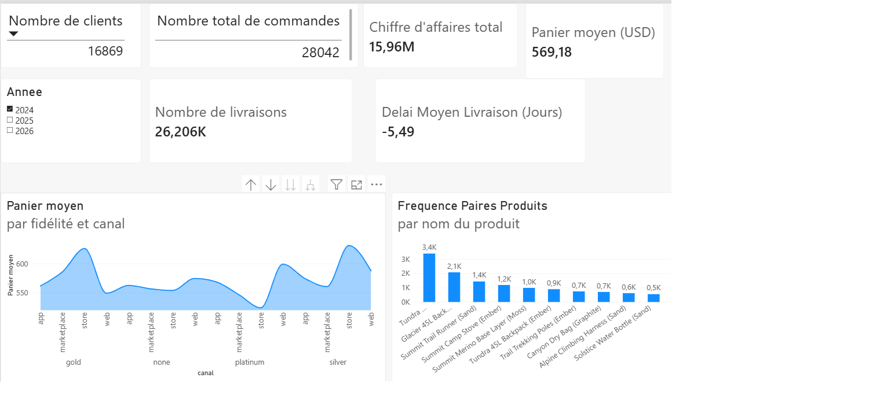
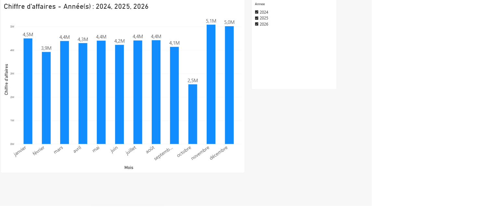
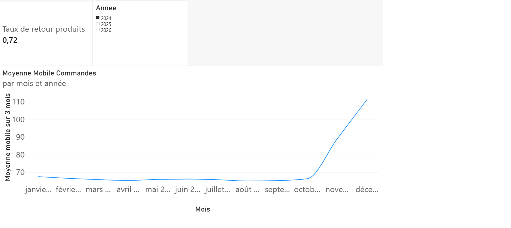
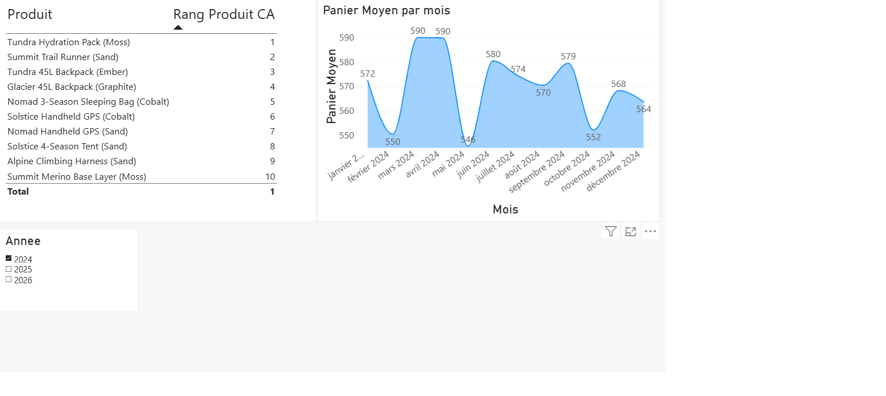
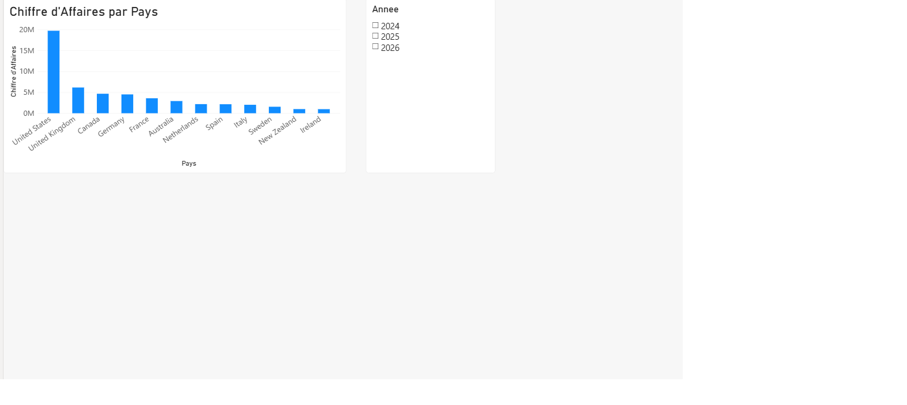

# Synthetic E-commerce Database — Analyse & KPIs

Ce fichier `README.md` présente la documentation technique et fonctionnelle des indicateurs clés de performance (KPIs) extraits de la base de données e-commerce **Synthetic**.

---

## 📋 Contexte du Projet

Ce projet centralise l'analyse exploratoire et le calcul des métriques stratégiques d'une plateforme e-commerce. À l'aide de requêtes SQL avancées sous PostgreSQL, l'objectif est d'évaluer la santé financière, la performance logistique, la typologie des clients et le comportement d'achat à partir de données de ventes, de produits, de clients et de livraisons.

---

## 🛠️ Stack Technique

* **Base de données :** PostgreSQL
* **Langage d'analyse :** SQL (Requêtes analytiques, fonctions de fenêtrage, CTEs)
* **Domaines couverts :** Finance, Logistique, Comportement client, Catalogue produits

---

## 📊 Principaux Axes d'Analyse & KPIs

### 1. Performance Commerciale & Financière
* **Chiffre d'affaires mensuel :** Suivi chronologique du volume des commandes, du sous-total, des remises appliquées et du chiffre d'affaires net (hors commandes annulées).
* **Analyse par Catégorie et par Marque :** Évaluation du chiffre d'affaires, de la marge brute et du taux de marge par catégorie d'articles et par marque partenaire.
* **Impact des Remises :** Suivi mensuel de la part des réductions accordées par rapport au montant brut des ventes.

### 2. Comportement et Segmentation Client
* **Valeur à Vie (LTV) :** Top 10 des clients générant le plus de chiffre d'affaires cumulé.
* **Fréquence d'Achat & Fidélité :** Répartition des clients selon le nombre de commandes passées (1 fois, 2 fois, 3 fois, ou plus de 3 fois) et calcul global du taux de récurrence (85,7 %).
* **Panier Moyen (AOV) & Canaux :** Analyse de la valeur moyenne des commandes croisée avec les canaux d'acquisition (web, app, store, marketplace) et les niveaux de fidélité (*platinum, gold, silver, none*).

### 3. Logistique & Chaîne d'Approvisionnement
* **Délai de Livraison Moyen :** Évaluation des performances logistiques par transporteur (Canada Post, DHL, DPD, FedEx, Royal Mail, UPS, USPS) avec un délai moyen stabilisé autour de 5,5 jours.
* **Analyse Géographique :** Suivi du chiffre d'affaires ventilé par pays de résidence des clients (porté principalement par les États-Unis, le Royaume-Uni et le Canada).
* **Politique de Livraison :** Suivi de la part des commandes bénéficiant de la gratuité des frais de port (maintenue à plus de 91 % sur les années 2024, 2025 et 2026).

### 4. Recommandation & Croisement de Produits
* **Panier d'Achat :** Mesure de la moyenne d'articles (3,69) et de références distinctes (2,21) par commande.
* **Associations de Produits :** Identification des paires d'articles les plus fréquemment achetées conjointement (ex: *Glacier 45L Backpack* et *Tundra Hydration Pack*).

---

## 📈 Indicateurs Avancés (SQL Avancé)

Le projet intègre également des requêtes reposant sur des concepts analytiques poussés :
* **Chiffre d'affaires cumulé :** Utilisation de la fonction de fenêtrage `SUM() OVER (ORDER BY mois)` pour suivre la progression financière continue.
* **Moyenne Mobile sur 3 mois :** Lissage des variations mensuelles du chiffre d'affaires via `AVG() OVER (ROWS BETWEEN 2 PRECEDING AND CURRENT ROW)`.
* **Classements (Ranking) :** Utilisation de `RANK()` pour hiérarchiser dynamiquement les clients et les produits les plus performants.

## 📊 Aperçu du rapport

